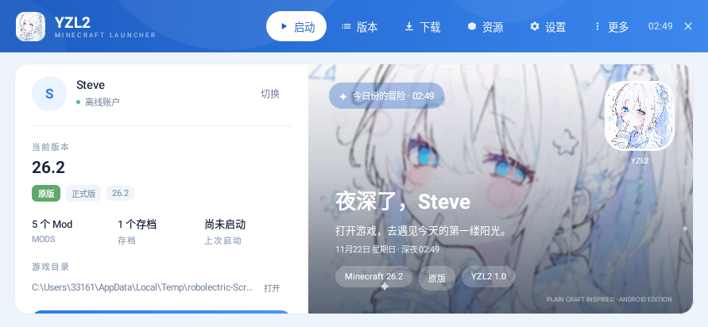
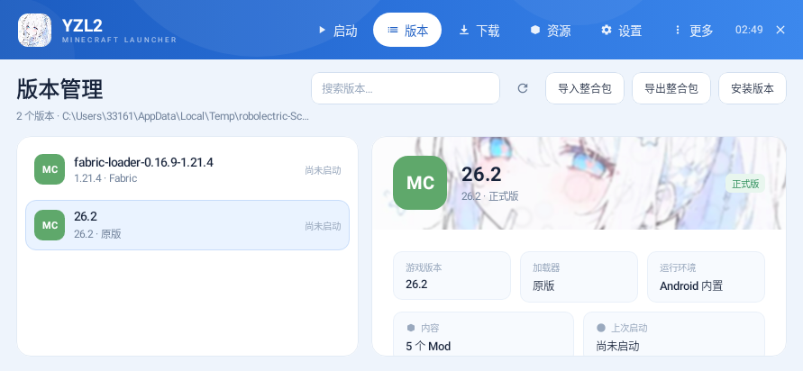
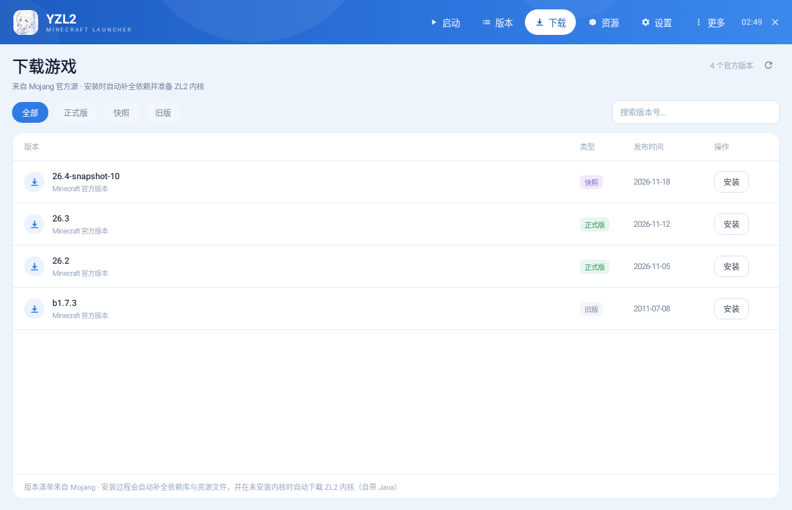
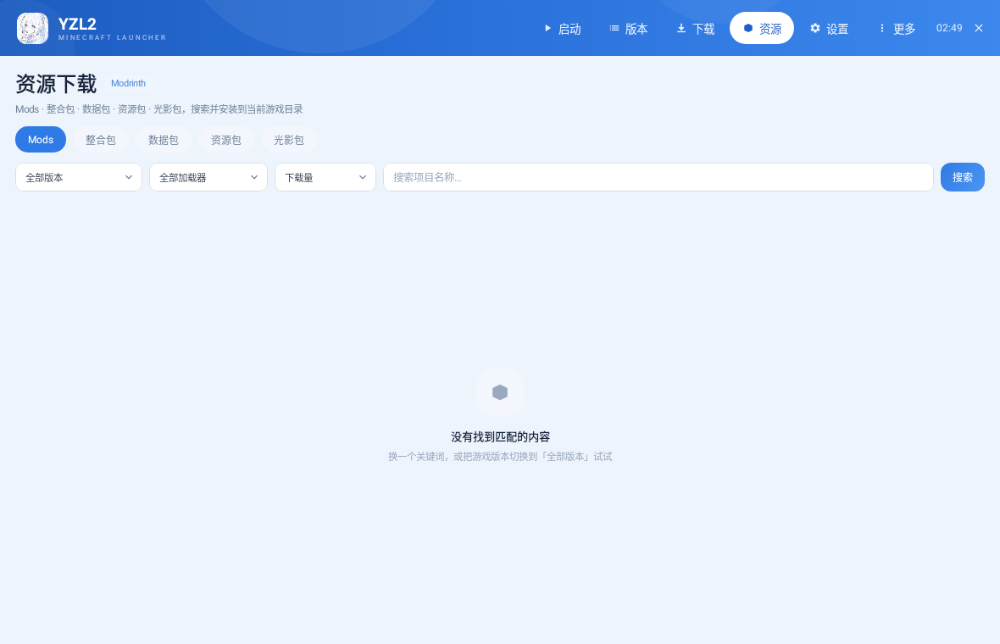
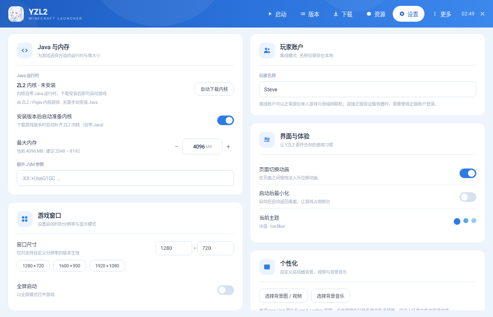
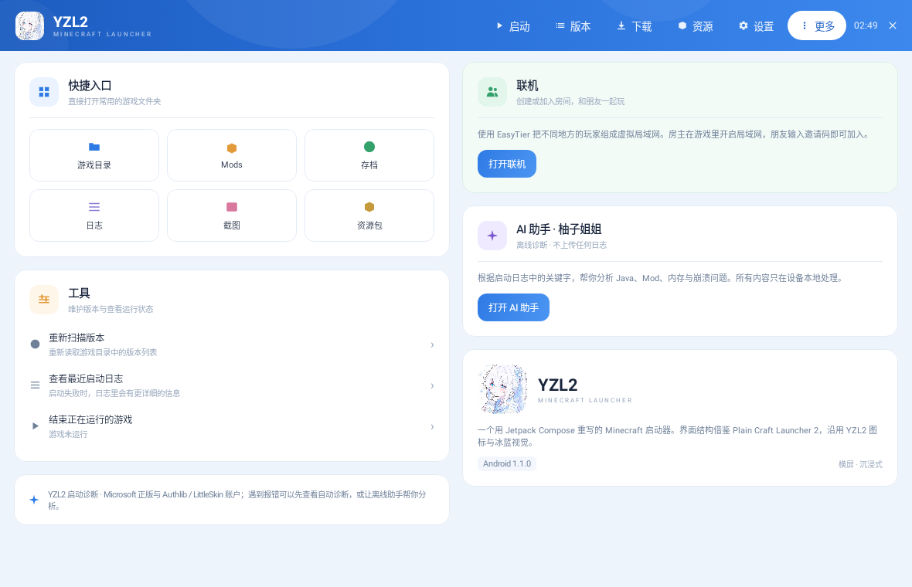
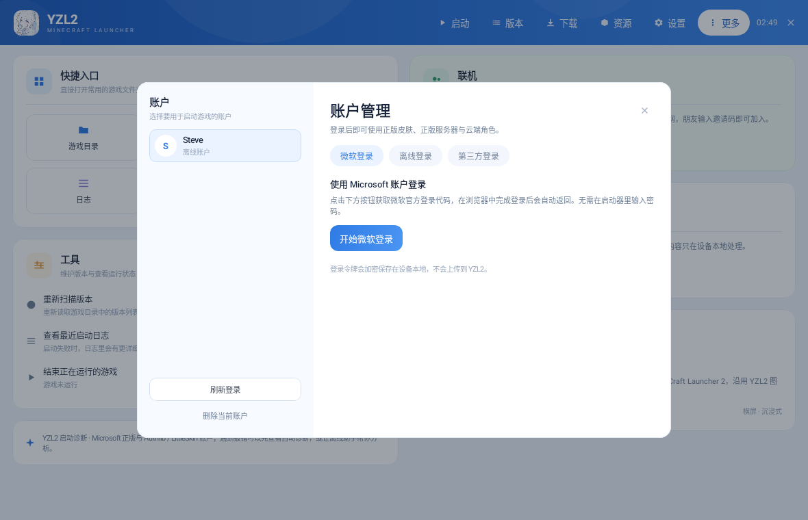
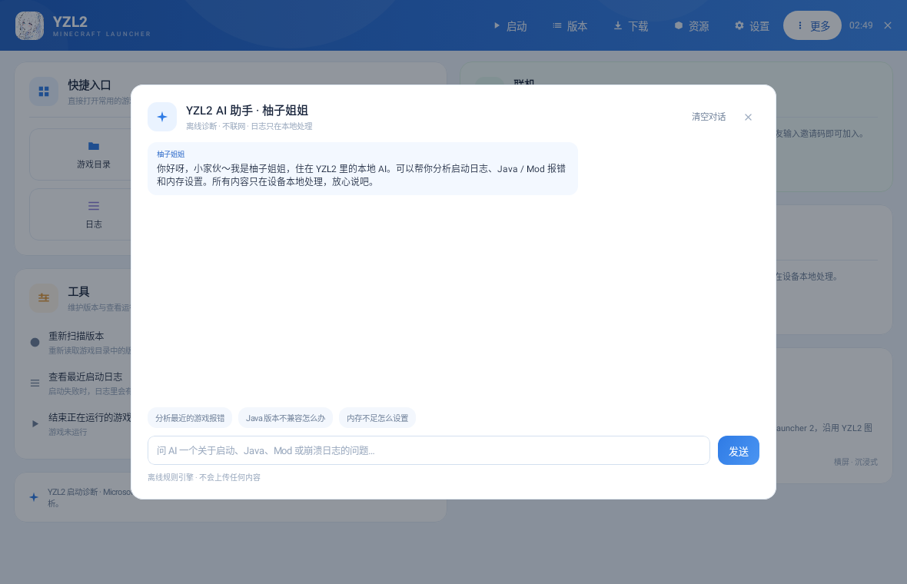
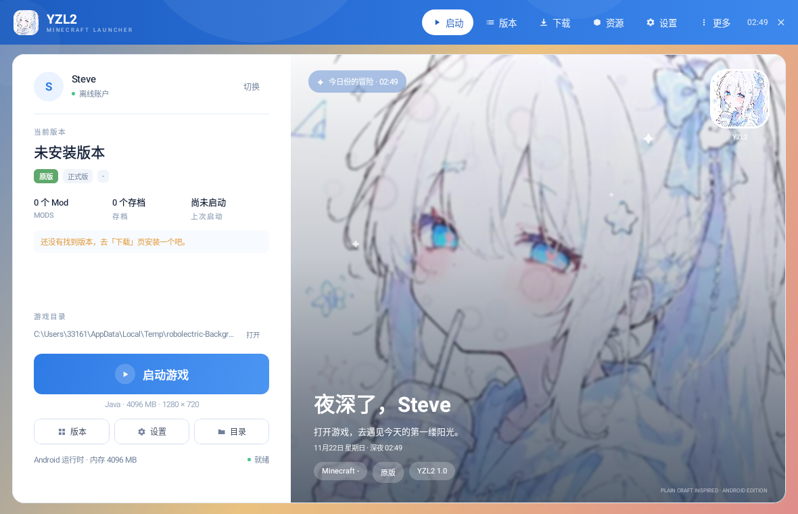
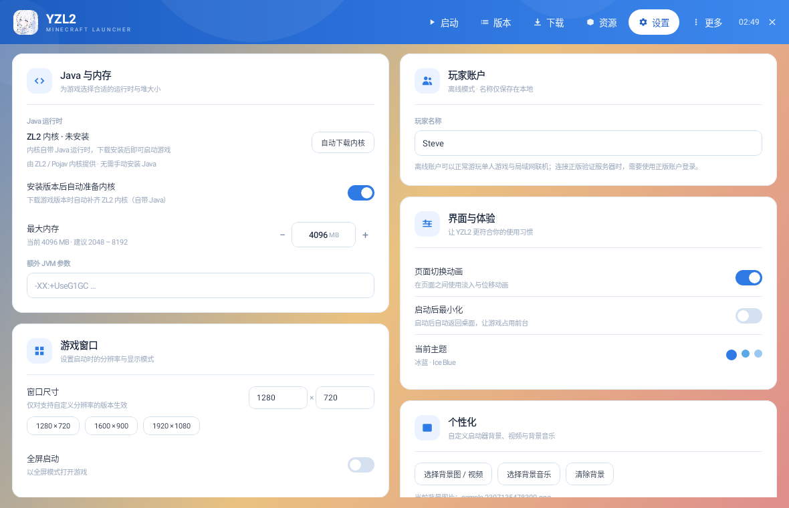

# YZL2 · PE 联机版 & Android 横屏移植版

[](../../releases/latest)
[](../../releases/latest)
[](../../releases/latest)
[](LICENSE)

> 把 Windows 上的 **YZL2**（WPF / .NET 10 的 Minecraft 启动器）变成两样能直接用的东西：
> **① Windows 端「PE 联机版」修复启动器**（补上原程序的资源缺失，下拉框不再崩溃）；
> **② Android 横屏移植版**（Kotlin + Compose，1:1 复刻界面与导航，自带下载 / 资源 / 账户 / AI 助手）。

本仓库同时收录**两套源码**与**两个可直接安装的本体**：源码在 `android/` 与 `windows/`，可执行文件在 [Releases](../../releases/latest)。

---

## 目录

- [这是什么](#这是什么)
- [两个发行物](#两个发行物)
- [截图](#截图)
- [下载与安装](#下载与安装)
- [Windows 版：修了什么](#windows-版修了什么)
- [Android 版：功能一览](#android-版功能一览)
- [从源码构建](#从源码构建)
- [仓库结构](#仓库结构)
- [已知限制](#已知限制)
- [FAQ](#faq)
- [免责声明与许可](#免责声明与许可)

---

## 这是什么

**YZL2** 是一款 Windows 上的轻量 Minecraft Java 版启动器（WPF 界面，单文件发行，约 62 MB）。它界面清透、带 EasyTier 联机面板与本地 GGUF 模型助手，但在部分版本中存在一个**下拉框高亮即崩溃**的资源缺陷。

本仓库是这个启动器的两件衍生工作：

| 项目 | 形态 | 说明 |
| --- | --- | --- |
| **YZL2 PE 联机版**（Windows） | 单个 `.exe` + `YZL2Hook.dll` | **不修改原程序**的外部修复启动器：通过 .NET Startup Hook 在运行时补上原程序忘记定义的 `AccentSoft` 画刷，从根上消除下拉框崩溃 |
| **YZL2 Android**（Android） | `.apk`（约 8.8 MB） | 把启动器的整套界面与业务重写为 **Android 横屏**应用：Compose 实现六个页面、Mojang / BMCLAPI 下载、Modrinth 资源、微软设备码登录、ZL2 内核联动 |

两者共享同一套视觉语言：`#EEF4FC` 冰蓝底、`#2F7BE5` 主色、`#1C5CC0 → #3C88ED` 顶栏渐变，以及原始的 Logo / 立绘 / 头像素材。

## 两个发行物

| | Windows · PE 联机版 | Android · 横屏移植版 |
| --- | --- | --- |
| 版本 | 1.0.0 | 1.1.0 |
| 产物 | `YZL2-PE-Launcher-1.0.0-win-x64.zip` | `YZL2-Android-1.1.0.apk` |
| 大小 | 轻量版 ≈ 0.6 MB / 免运行时版 ≈ 38 MB | ≈ 8.8 MB |
| 运行要求 | Windows 10/11 x64；轻量版需 .NET 10 桌面运行时 | Android 8.0+（minSdk 26），横屏 |
| 额外依赖 | **原版 YZL2 启动器本体**（自备，写入 `target.txt`） | 运行 Minecraft 需 ZL2 / PojavLauncher 内核（安装版本时自动下载） |
| 技术栈 | C# / .NET 10 / Win32 | Kotlin 2.0 · Jetpack Compose · Material 3 |

> 两个包都**不含 Minecraft 游戏本体**，也不含任何 Mojang 资源文件。

## 截图

| 启动页 | 版本管理 |
| --- | --- |
|  |  |

| 下载游戏 | 资源下载 |
| --- | --- |
|  |  |

| 设置 | 更多 |
| --- | --- |
|  |  |

| 账户 | AI 助手 |
| --- | --- |
|  |  |

| 自定义视频背景 | 个性化设置 |
| --- | --- |
|  |  |

## 下载与安装

### Windows · YZL2 PE 联机版

1. 到 [Releases](../../releases/latest) 下载 **`YZL2-PE-Launcher-1.0.0-win-x64.zip`**（轻量版）或 **`YZL2-PE-Launcher-1.0.0-win-x64-full.zip`**（自带 .NET 运行时，免安装运行时，推荐给不确定环境的人）。
2. 解压到**任意目录**（不要只把 exe 拖出来，它需要同目录的 `YZL2Hook.dll`）。
3. 用记事本打开同目录的 **`target.txt`**，把内容改成**原版 YZL2 启动器**的完整路径，例如：
   ```
   D:\Games\YZL2\YZL2.exe
   ```
4. 双击 **`YZL2 PE联机版.exe`**，原启动器会带着修复补丁正常启动。

- 没有 `target.txt` / 路径写错时，程序会弹出提示告诉你缺什么，不会静默失败。
- 修复只发生在**运行时**：原版 `YZL2.exe` 一个字节都不会被改动，删掉本工具即可完全还原。
- 日志：`%TEMP%\yzl2_hook.log`，可确认补丁是否生效（`resource 'AccentSoft' added to Application.Resources`）。

### Android · YZL2 横屏移植版

1. 下载 `YZL2-Android-1.1.0.apk` 传到手机安装，或 `adb install -r YZL2-Android-1.1.0.apk`。
2. 首次进入即**横屏沉浸式**界面：启动 / 版本 / 下载 / 资源 / 设置 / 更多。
3. 在「下载」中选一个版本点「安装」，装完会自动检查并按 CPU ABI 下载 **ZL2 内核**（Zalith Launcher 2），再调起系统安装器；之后点「启动」会把工作交给内核。
4. 从 1.0.x 升级请先卸载旧版（签名不同，本地账户与设置会重置）。

> 1.1.0 的签名使用仓库内自签名证书 `android/yzl2-release.jks`（别名 `yzl2`，口令 `yzl2android`），仅供侧载，**请勿用于上架商店**。

## Windows 版：修了什么

原版 YZL2 在**下拉框（ComboBox）条目被高亮 / 悬停**时会直接抛出异常并中断渲染：

```
System.InvalidOperationException: “DependencyProperty.UnsetValue”不是属性“Background”的有效值。
   在 System.Windows.Controls.Border.OnRender(...)
```

追下去是 WPF 的资源键笔误：

- `ContentView.xaml` 里的 `ComboBoxItem` 控件模板触发器使用了 `{StaticResource AccentSoft}`；
- 但 `Themes/Theme.xaml` 只定义了 **`AccentSoftBrush`**；
- BAML 里的 `StaticResource` 是**延迟解析**的，键不存在时不会在加载期报错，而是解析成 `DependencyProperty.UnsetValue` —— 等到 `Border.OnRender` 想把它当画刷用时才炸。

修复方式（本仓库 `windows/hook/`）：

```csharp
// DOTNET_STARTUP_HOOKS 注入，在 Application 创建后、任何视图创建前执行
resources["AccentSoft"] = CreateBrush();   // SolidColorBrush #EAF3FF，与 AccentSoftBrush 同色
```

- 钩子只对进程名包含 `YZL2` 的目标生效，用反射调用 WPF，不引用 WPF 程序集；
- 通过 `Dispatcher.BeginInvoke` 在 `Send` / `ApplicationIdle` 两个优先级重复注入，兼容各种启动时序；
- 除非目标程序自身崩溃，钩子出任何问题都会被吞掉，绝不影响宿主进程。

启动器 `windows/launcher/` 只做三件事：读 `target.txt` → 设置 `DOTNET_STARTUP_HOOKS` → 用原参数拉起原程序。

## Android 版：功能一览

| 模块 | 说明 |
| --- | --- |
| 启动页 | 账户卡片、当前版本、Mod / 存档 / 上次启动统计、游戏目录、渐变启动按钮、快捷入口、Java 摘要；右侧立绘与按时段变化的问候语、日期、徽章 |
| 版本管理 | 扫描游戏目录内版本，列表 / 详情双栏，加载器与类型徽章，启动 / 打开目录 / 刷新 |
| 下载游戏 | Mojang `version_manifest_v2`（官方源，失败回退 BMCLAPI）、正式版 / 快照 / 旧版筛选、搜索、一键安装（客户端 + 依赖库 + 资源索引与 objects，带进度与取消），装完自动准备 ZL2 内核 |
| 资源下载 | Modrinth 搜索（Mods / 整合包 / 数据包 / 资源包 / 光影包）、版本 / 加载器 / 排序筛选、安装到当前实例 `mods` |
| 账户 | 微软设备码登录（OAuth → Xbox Live → XSTS → Minecraft Services 全链路）、LittleSkin / Authlib 第三方登录、离线账户、多账户切换与删除 |
| 运行环境 | 识别 ZL2 / Pojav 内核（含 `com.movtery.zalithlauncher.v2`），按 CPU ABI 下载内核 APK（官方源 + 镜像），FileProvider 调起安装器 |
| 设置 | 最大内存、额外 JVM 参数、窗口尺寸与预设、全屏、动画、主题色、内核状态与「自动下载内核」 |
| 个性化 | 系统文件选择器指定背景图 / 视频 / 背景音乐（可进入任意文件夹），视频循环播放与静音，音乐自动播放与音量 |
| 更多 | 快捷入口、工具（重新扫描 / 查看日志 / 结束游戏）、联机面板、AI 助手、关于与诊断 |
| AI 助手 | 「柚子姐姐」**离线**规则引擎：按问题与 `logs/latest.log` 关键字分析 Java / Mod / 内存 / 崩溃，不联网、不上传 |
| 诊断 | 启动 / 安装失败时的错误卡片：原因、处理建议、日志与「AI 分析」 |

### 1.1.0 更新

- **装版本自动备好「Java + 内核」**：安装完成后自动检测 ZL2 内核，未安装则按 ABI 下载对应 APK 并调起安装器；Java 由内核自带。
- **背景可选任意文件夹的文件**：图片 / 视频经系统文件选择器挑选后复制进私有目录，重启仍生效。
- **视频背景循环播放**：`TextureView + MediaPlayer` 全屏铺满，可开关循环与静音；另支持循环背景音乐与音量。

### 1.0.1 修复记录

- 修复安装 404：不再把官方域名替换成 BMCLAPI，而是「官方源优先、失败按 BMCLAPI 规范路径回退」。
- 搜索改为独立按钮，支持重复搜索、30 秒超时与错误提示。
- 恢复所有按钮的涟漪反馈；安装即弹 Toast 与进度浮层，失败时给出诊断卡片。
- 连接 12 秒 / 读取 25 秒超时，清单与搜索可取消后重试。
- 未选中版本时不再把 Mod 下载到游戏根目录。

## 从源码构建

### Android

需要 **JDK 21** + **Android SDK 35**（`local.properties` 里写 `sdk.dir`）。

```bash
cd android
./gradlew assembleDebug      # 调试包
./gradlew assembleRelease    # 发布包（用仓库内 yzl2-release.jks 签名）
```

产物：`app/build/outputs/apk/release/app-release.apk`。仓库已内置 Gradle Wrapper（8.13），无需预装 Gradle。

### Windows

需要 **.NET 10 SDK**。

```powershell
# 1) 编译 Startup Hook
dotnet build windows/hook/hook.csproj -c Release

# 2) 发布启动器（轻量版：单文件、依赖 .NET 10 桌面运行时）
dotnet publish windows/launcher/launcher.csproj -c Release -r win-x64 `
  -p:PublishSingleFile=true -o out

# 2') 或发布免运行时版（约 38 MB，自带运行时）
dotnet publish windows/launcher/launcher.csproj -c Release -r win-x64 `
  --self-contained true -p:PublishSingleFile=true `
  -p:IncludeNativeLibrariesForSelfExtract=true -p:EnableCompressionInSingleFile=true -o out

# 3) 把 YZL2Hook.dll 与 target.txt 放到 out\ 下，与原程序一起使用
```

## 仓库结构

```
YZL2-PE/
├── android/                     # Android 横屏移植版（Kotlin + Compose）
│   ├── app/src/main/java/com/yzl2/launcher/
│   │   ├── MainActivity.kt      # 横屏、沉浸式入口
│   │   ├── AppViewModel.kt      # 状态与业务编排
│   │   ├── data/                # 配置、账户、版本、Mojang、Modrinth、认证、内核下载、转交启动、AI
│   │   └── ui/                  # 主题、组件、六个页面、背景 / 音乐、浮层
│   ├── app/src/main/assets/     # logo / hero / art 原素材
│   ├── app/src/test/            # Robolectric 交互与截图测试
│   └── README.md                # 更详细的实现说明
├── windows/
│   ├── launcher/                # 修复启动器（读 target.txt → 设 Startup Hook → 拉起原程序）
│   └── hook/                    # Startup Hook（注入缺失的 AccentSoft 画刷）
└── README.md
```

## 已知限制

1. **Android 版不能直接运行 Minecraft Java 版**：桌面版依赖 JVM + LWJGL / OpenGL，需要 ZL2 / PojavLauncher 这类内核。本移植版是启动器的**界面与资源管理端**，点「启动」会转交内核。
2. EasyTier 打洞联机与本地 GGUF 模型未内置：联机面板与 AI 助手为离线实现。
3. 整合包导入 / 导出为占位提示；Forge / NeoForge 安装未实现（原版与 Fabric 已支持）。
4. 游戏目录默认 `Android/data/com.yzl2.launcher/files/minecraft`（应用专属外部存储，卸载即清除）。
5. Windows 修复工具**依赖原版 YZL2 启动器**：本仓库不附带原版本体。

## FAQ

**Q：为什么不直接改原程序，而要用 Startup Hook？**
A：改 BAML 需要重打包，破坏原文件且易被更新覆盖。Hook 只注入一个资源键，零侵入、可随时撤掉。

**Q：修复后仍然崩？**
A：看 `%TEMP%\yzl2_hook.log`。没有 `hook active` 说明钩子没加载（`DOTNET_STARTUP_HOOKS` 未被继承或 `YZL2Hook.dll` 缺失）；出现 `Inject failed` 请附上日志开 issue。

**Q：Windows 版提示缺少 .NET 运行时？**
A：换用 `-full` 免运行时包，或安装 .NET 10 Desktop Runtime。

**Q：能上架应用商店 / 能内置 Minecraft 吗？**
A：都不能。本项目不含游戏本体与 Mojang 资源，按 MIT 仅供学习与个人使用。

## 免责声明与许可

- 本项目**非官方**产物，与 Mojang Studios、Microsoft、YZL2 原作者均无隶属关系。
- 仓库**不包含** Minecraft 游戏文件、原始启动器本体或其反编译代码；Android 端仅包含自行绘制的界面素材。
- 「Minecraft」为 Mojang Studios 的商标；请在遵守 Minecraft EULA 的前提下使用。
- 原版 YZL2 启动器的著作权归其作者所有，本仓库的修复工具与移植代码不主张其权利。
- 本仓库代码以 **MIT** 许可发布，详见 [LICENSE](LICENSE)。使用风险自负。
