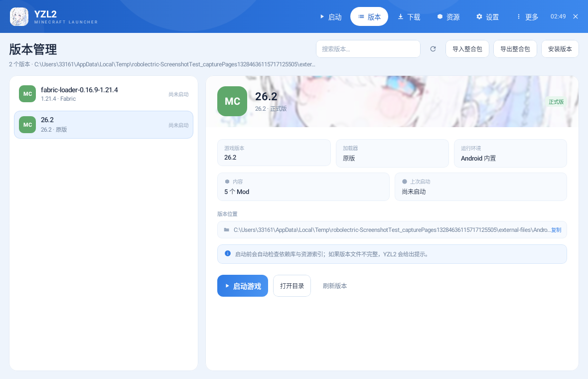
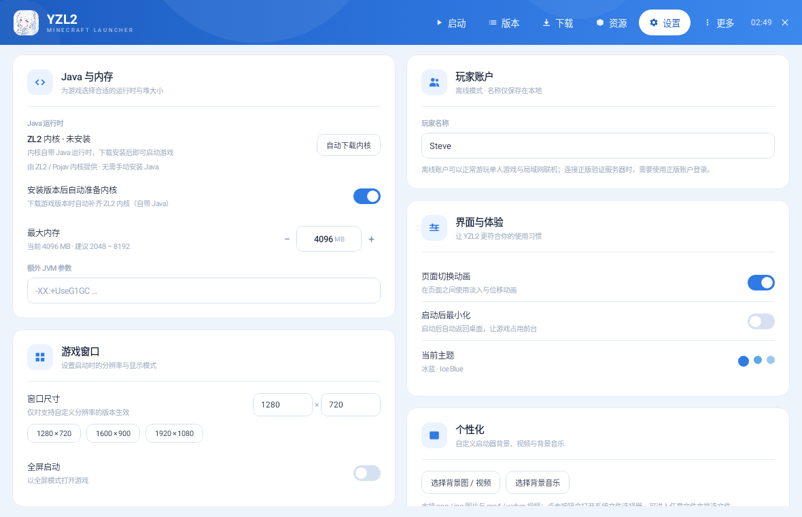
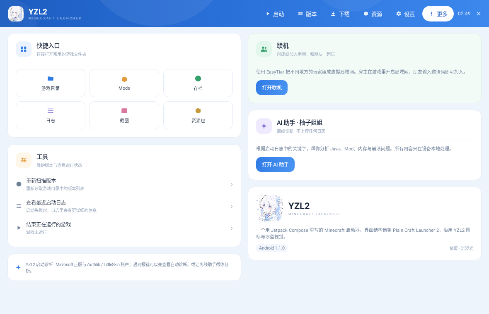
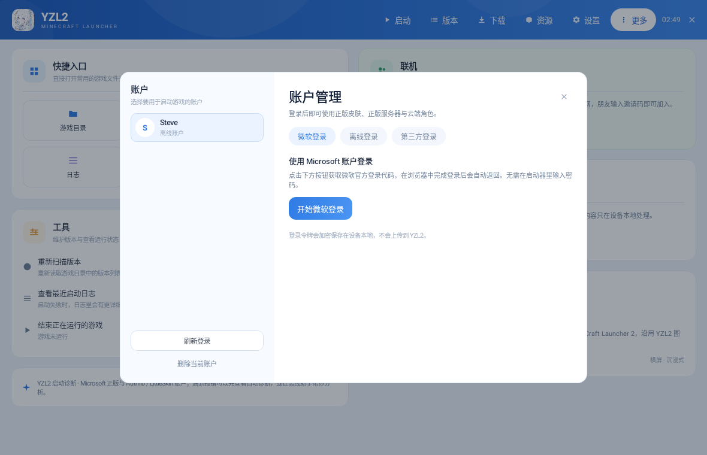
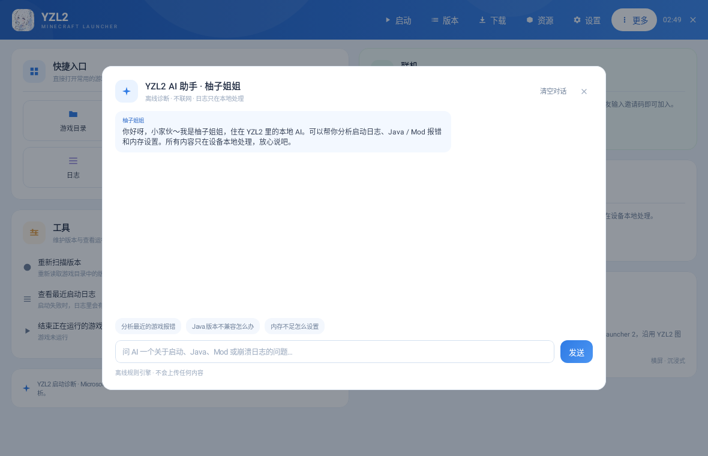
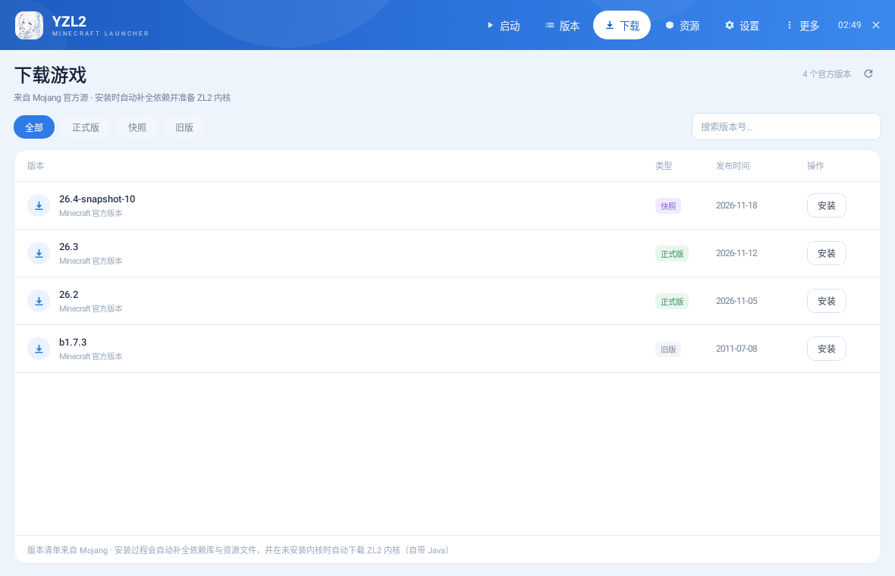
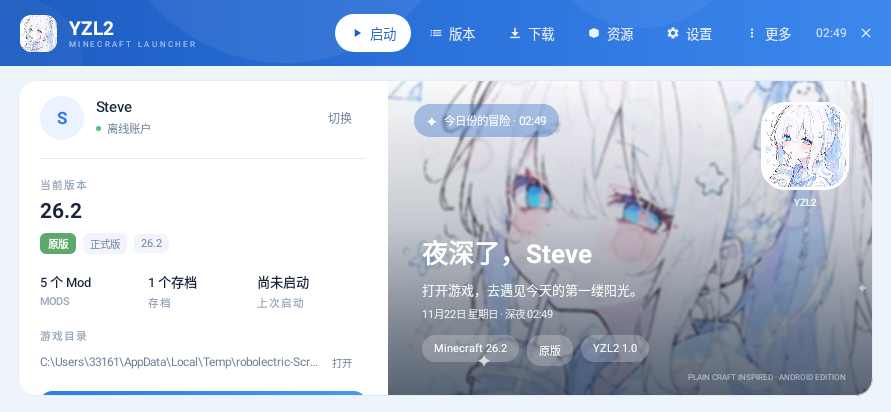
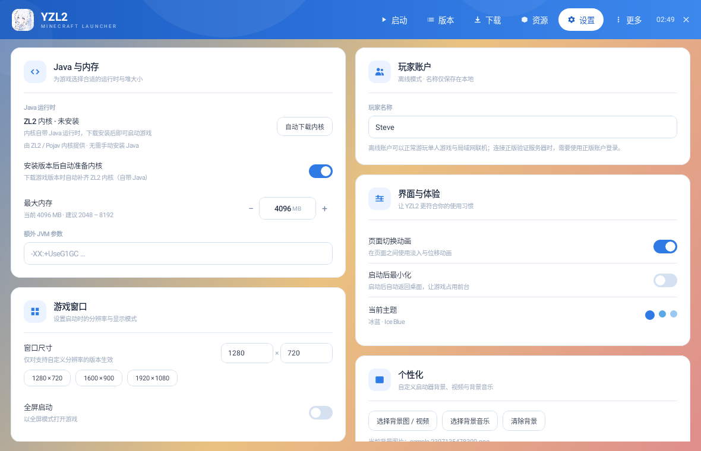

# YZL2 · Android（横屏移植版）

把 Windows 上的 **YZL2（WPF / .NET 10，Minecraft 启动器）** 以 1:1 的视觉与导航结构重写为 **Android 横屏** 应用：Kotlin + Jetpack Compose + Material 3，强制横屏、沉浸式全屏。

界面沿用原程序的冰蓝主题（`#EEF4FC` 背景、`#2F7BE5` 主色、`#1C5CC0→#3C88ED` 顶栏渐变）、Logo / 立绘 / 头像资源，以及「启动 / 版本 / 下载 / 资源 / 设置 / 更多」六个页面的布局与文案。

当前版本：**1.1.0**（新增：安装版本时自动下载 ZL2 内核、自定义背景 / 循环视频背景、背景音乐）。

## 1.1.0 更新

- **下载版本自动准备「Java + 内核」**：点「安装」时，版本文件装完后会自动检查 ZL2 内核（Zalith Launcher 2，包名 `com.movtery.zalithlauncher` / `.v2`）；未安装时按当前 CPU ABI（arm64-v8a / armeabi-v7a / x86_64）从官方 Release 下载对应 APK，再调起系统安装器。Java 运行时由内核自带，不需要单独安装 Java。设置页新增「自动下载内核」按钮与内核状态显示。
- **自定义背景可以选择文件夹里的任意文件**：设置 → 个性化 → 「选择背景图 / 视频」会打开系统文件选择器，可进入任意文件夹挑选 png / jpg 图片或 mp4 / webm 视频；文件会复制到应用私有目录，重启后仍然生效。
- **视频背景支持循环播放**：视频背景使用 `TextureView + MediaPlayer` 全屏铺满，可开关「循环播放视频」「视频静音」，默认循环、默认静音；另支持循环播放自定义背景音乐与音量调节。

## 1.0.1 修复记录

- **安装失败**：旧版把官方 URL 的域名直接替换成 BMCLAPI 域名，拼出的路径无效（404），导致点「安装」后下载立即失败。现改为：优先官方源，失败后按 BMCLAPI 规范路径回退（版本 JSON `/version/{id}/json`、客户端 `/version/{id}/client`、依赖库 `/maven/{path}`、资源索引 `/assets/indexes/{id}.json`、资源对象 `/assets/{h2}/{hash}`）。
- **搜索按钮**：旧版把「搜索」做成输入框内的 trailing 元素，容易点不到；现改为独立蓝色按钮，并支持重复搜索、30 秒超时与错误提示。
- **按钮反馈**：所有按钮恢复涟漪 / 按压反馈；安装开始立即弹 Toast 与进度浮层，失败时清空进度并弹出诊断卡片。
- **网络健壮性**：连接 12 秒 / 读取 25 秒超时；版本清单和搜索支持取消后重试，不再出现"点一次就一直转圈、再点没反应"。
- **资源安装**：没有选中版本时先提示安装 / 选择版本，不再把 Mod 下载到游戏根目录。

新增 Robolectric 交互测试：`InteractionTest` 会真实点击「搜索」「安装」并断言已触发逻辑。


## 截图

| 启动页 | 版本管理 |
| --- | --- |
|  |  |

| 设置 | 更多 |
| --- | --- |
|  |  |

| 账户 | AI 助手 |
| --- | --- |
|  |  |

| 下载 | 手机横屏 |
| --- | --- |
|  |  |

| 自定义背景（图片） | 个性化设置 |
| --- | --- |
|  |  |


## 已实现

| 模块 | 说明 |
| --- | --- |
| 启动页 | 账户卡片、当前版本、Mod / 存档 / 上次启动统计、游戏目录、渐变启动按钮、快捷入口、Java 摘要；右侧立绘 + 按时段变化的问候语、日期、徽章、星点 |
| 版本管理 | 扫描游戏目录下的版本、列表 / 详情双栏、加载器与类型徽章、版本位置、启动 / 打开目录 / 刷新 |
| 下载游戏 | Mojang `version_manifest_v2`（官方源，失败回退 BMCLAPI 镜像）、全部 / 正式版 / 快照 / 旧版筛选、搜索、一键安装（客户端 jar + 依赖库 + 资源索引与 objects，带进度与取消）、装完后自动准备 ZL2 内核 |
| 资源下载 | Modrinth 搜索（Mods / 整合包 / 数据包 / 资源包 / 光影包）、版本 / 加载器 / 排序筛选、下载安装到当前实例 mods |
| 账户 | Microsoft 设备码登录（完整 OAuth → Xbox Live → XSTS → Minecraft Services 链路）、LittleSkin / Authlib 第三方登录、离线账户、多账户切换与删除、本地持久化 |
| 运行环境 | 自动识别 ZL2 / Pojav 内核（含 `com.movtery.zalithlauncher.v2`）、按 CPU ABI 从官方 Release 下载内核 APK（官方源 + 两个镜像）、FileProvider 调起系统安装器、下载进度与取消 |
| 设置 | 最大内存、额外 JVM 参数、窗口尺寸与预设、全屏、动画、启动后最小化、主题色、内核状态与「自动下载内核」、安装版本后自动准备内核开关 |
| 个性化 | 通过系统文件选择器指定背景图片 / 视频 / 背景音乐（可进入任意文件夹）、背景视频循环播放、视频静音、背景音乐自动播放与音量 |
| 更多 | 快捷入口（目录 / Mods / 存档 / 日志 / 截图 / 资源包）、工具（重新扫描 / 查看日志 / 结束游戏）、联机面板、AI 助手入口、关于与诊断 |
| AI 助手 | 「柚子姐姐」离线规则引擎：根据问题与 `logs/latest.log` 关键字分析 Java / Mod / 内存 / 崩溃问题，不联网、不上传 |
| 诊断 | 启动失败、安装失败等场景的白底错误卡片：原因、处理建议、日志与「AI 分析」 |

## 已知限制（重要）

1. **不能在 Android 上直接运行 Minecraft Java 版。** 桌面版依赖 JVM + LWJGL / OpenGL 运行时，Android 端需要 PojavLauncher / Zalith Launcher 2（ZL2）这类内核。本移植版是启动器的**界面与资源管理端**：
   - 点击「启动游戏」会先完成准备流程，然后检测已安装的 **ZL2 启动器**（`com.movtery.zalithlauncher`）或 **PojavLauncher**（`net.kdt.pojavlaunch`），存在则转交给它启动；
   - 安装版本时会自动下载并安装 ZL2 内核；也可以在设置页手动触发。
2. EasyTier 打洞联机与本地 GGUF 模型（LLaMA.cpp）没有内置，联机面板与 AI 助手为离线实现。
3. 整合包导入 / 导出按钮目前为占位提示；Forge / NeoForge 安装未实现（原版与 Fabric 已支持）。
4. 游戏目录默认位于 `Android/data/com.yzl2.launcher/files/minecraft`（应用专属外部存储，卸载即清除）。

## 构建

```bash
# JDK 17/21 + Android SDK 35
./gradlew assembleDebug      # 调试包
./gradlew assembleRelease    # 发布包（使用仓库内 yzl2-release.jks 签名）
```

产物：

- `app/build/outputs/apk/release/app-release.apk`（约 8.8 MB）
- 发行版：仓库 [Releases](../../releases/latest) 中的 `YZL2-Android-1.1.0.apk`

安装：把 APK 传到手机后直接安装，或 `adb install -r YZL2-Android-1.1.0.apk`。首次进入即为横屏沉浸式界面。

> 注意：1.0.x 的签名证书已随旧工程丢失，1.1.0 使用重新生成的 `yzl2-release.jks`，签名不同。如果手机里已经装着 1.0.x，需要先卸载旧版再安装（本地账户与设置会重置）。

签名证书：`yzl2-release.jks`，别名 `yzl2`，口令 `yzl2android`（自签名，仅用于侧载；上架应用商店请替换为自己的正式证书）。

## 目录

```
app/src/main/java/com/yzl2/launcher/
├── MainActivity.kt          # 横屏、沉浸式入口
├── AppViewModel.kt          # 状态与业务编排
├── data/                    # 配置、账户、版本、Mojang、Modrinth、认证、内核下载、启动转交、AI
└── ui/                      # 主题、组件、六个页面、背景/音乐与浮层
app/src/main/assets/         # logo / hero / art 原素材
app/src/test/.../ScreenshotTest.kt  # Robolectric 截图（可选）
```
